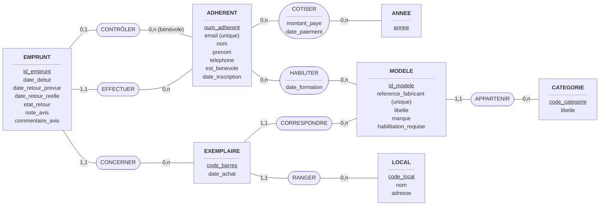
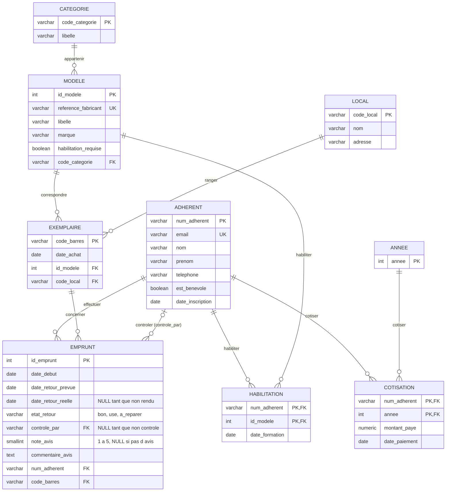

# Conception et architecture des données — TP final

**Bachelor 3 · Ycode A2627_4672**

| | |
|---|---|
| **Membres** | Loulia Tsui, Mathis Valentin, Raphaël Bigord |
| **Sujet** | « Prêt’Outil », une outilthèque de quartier |
| **Dépôt** | https://github.com/RBigord/archi_des_donn-es_TP-final.git |
| **Date de rendu** | vendredi 13 novembre 2026, 23 h 59 |

---

## Sommaire

1. [Présentation du sujet](#0-présentation-du-sujet)
2. [Le cahier des charges](#1-le-cahier-des-charges)
3. [Le MCD](#2-le-mcd-modèle-conceptuel-de-données)
4. [Le MLD](#3-le-mld-modèle-logique-de-données)
5. [Ce que le schéma garantit, et où on garantit le reste](#4-ce-que-le-schéma-garantit-et-où-on-garantit-le-reste)
6. [Le choix de la base — ADR](#5-le-choix-de-la-base--adr)
7. [Bonus — L'implémentation](#6-bonus--limplémentation)

---

## 0. Présentation du sujet

Une association prête des outils à ses adhérents : perceuses, échelles, tondeuses, nettoyeurs haute pression. Elle a environ 300 outils dans 2 locaux, 800 adhérents et 6 000 emprunts par an. Le samedi matin, plusieurs adhérents réservent souvent le même outil en même temps. L’adhérent réserve en ligne, récupère l’outil, puis le rend. Un bénévole vérifie alors l’état de l’outil. Les outils dangereux, comme la tronçonneuse, demandent une formation avant de pouvoir être empruntés.

&nbsp;

**Questions auxquelles la base doit répondre :**

1. Quels outils d’un local sont libres entre deux dates ?
2. Quels emprunts sont en retard aujourd’hui ?
3. Quels sont les 10 modèles les plus empruntés de l’année ?
4. Quel est l’historique d’un outil : qui l’a emprunté, quand, et dans quel état il est revenu ?
5. Quels adhérents ont une cotisation qui expire ce mois-ci ?

&nbsp;

---

## 1. Le cahier des charges

### 1.1 Règles de gestion

| N° | Règle de gestion | Cardinalité / contrainte déduite |
|----|------------------|----------------------------------|
| RG1 | Chaque adhérent a un numéro d’adhérent unique, donné à l’inscription. Son e-mail est unique aussi. | Identifiant métier : n° d’adhérent unique ; e-mail unique |
| RG2 | Un adhérent paie au plus une cotisation par année. Pour emprunter, il doit toujours avoir payé celle de l’année en cours. | COTISER : Adhérent (0,n) — Année (0,n) ; au plus une cotisation par couple (adhérent, année) ; cotisation de l’année en cours obligatoire pour emprunter |
| RG3 | Chaque modèle d’outil (par exemple « Perceuse Bosch PSB 500 ») appartient à exactement une catégorie. Une catégorie peut contenir zéro ou plusieurs modèles. | Modèle (1,1) — Catégorie (0,n) |
| RG4 | Chaque outil physique (un exemplaire) a un code-barres unique. Il correspond toujours à un seul modèle. Un modèle peut avoir zéro ou plusieurs exemplaires. | Identifiant métier : code-barres unique ; Exemplaire (1,1) — Modèle (0,n) |
| RG5 | Un exemplaire est rangé dans exactement un local. | Exemplaire (1,1) — Local (0,n) |
| RG6 | Un emprunt concerne un seul adhérent et un seul exemplaire. Un adhérent a au plus 3 emprunts en cours. | Emprunt (1,1) — Adhérent (0,n) ; Emprunt (1,1) — Exemplaire (0,n) ; au plus 3 emprunts en cours par adhérent |
| RG7 | Deux emprunts du même exemplaire ne se chevauchent jamais dans le temps. | Contrainte : pas de chevauchement de périodes pour un même exemplaire |
| RG8 | Un emprunt a toujours une date de début et une date de retour prévue, au plus 14 jours plus tard. La date de retour réelle est facultative tant que l’outil n’est pas rendu. | Date de début et date de retour prévue obligatoires ; retour prévue ≤ début + 14 jours ; date de retour réelle facultative |
| RG9 | Chaque retour est contrôlé par exactement un bénévole, qui note l’état : bon, usé ou à réparer. | CONTRÔLER : Emprunt (0,1) — Adhérent bénévole (0,n) ; état ∈ {bon, usé, à réparer} |
| RG10 | Certains modèles demandent une habilitation. Un adhérent ne peut les emprunter que s’il a suivi la formation, et on garde la date de cette formation. | Adhérent (0,n) — Modèle (0,n) via « Habilitation » (porte la date de formation) ; habilitation obligatoire pour emprunter un modèle qui l’exige |
| RG11 | Après un emprunt, l’adhérent peut laisser au plus un avis, avec une note de 1 à 5. L’avis est facultatif. | Au plus un avis par emprunt, facultatif (attributs de l’emprunt) ; note ∈ [1, 5] |

### 1.2 Questions qu'on s'est posées

| Question | Réponse retenue | Règle concernée |
|----------|-----------------|-----------------|
| Une catégorie peut-elle être vide ? | Oui. On crée la catégorie avant d’acheter les outils qui vont dedans. | RG3 |
| Un modèle peut-il n’avoir aucun exemplaire ? | Oui. Quand tous ses exemplaires sont mis au rebut, on garde le modèle pour l’historique. | RG4 |
| L’emprunt est-il une entité ou une association ? | Une entité. Le même adhérent peut emprunter plusieurs fois le même outil, et le contrôle et l’avis renvoient chacun à un emprunt précis. | RG6, RG9, RG11 |
| Le bénévole est-il une entité à part ? | Non. C’est un adhérent qui a le rôle de bénévole. | RG9 |
| Que devient l’historique si un adhérent se désinscrit ? | On rend ses données anonymes (RGPD) au lieu de le supprimer. Sinon on perdrait les statistiques. | RG1, RG6 |

&nbsp;

---

## 2. Le MCD (Modèle Conceptuel de Données)

### 2.1 Schéma

> Notation Merise : les rectangles sont les entités (identifiant souligné), les ovales sont les associations, et les cardinalités sont écrites sur les liens.



&nbsp;

### 2.2 Entités et identifiants

| Entité | Identifiant | Identifiant métier | Attributs principaux |
|--------|-------------|--------------------|----------------------|
| ADHERENT | num_adherent | Oui : le numéro de carte ; l’e-mail est unique aussi (RG1) | email, nom, prenom, telephone, est_benevole, date_inscription |
| CATEGORIE | code_categorie | Oui | libelle |
| MODELE | id_modele | Référence fabricant | reference_fabricant, libelle, marque, habilitation_requise |
| EXEMPLAIRE | code_barres | Oui (RG4) | date_achat (le statut « sorti » est calculé, voir l’ADR) |
| LOCAL | code_local | Oui | nom, adresse |
| EMPRUNT | id_emprunt | Non (identifiant technique) | date_debut, date_retour_prevue, date_retour_reelle, etat_retour, note_avis, commentaire_avis |
| ANNEE | annee | Oui | — |

> Le bénévole n’est pas une entité : c’est un ADHERENT avec `est_benevole = vrai` (voir 1.2).
> L’avis (RG11) et l’état au retour (RG9) sont des attributs d’EMPRUNT, puisqu’il y a au plus un avis et un contrôle par emprunt.

### 2.3 Associations et cardinalités

| Association | Entité A | Card. A | Entité B | Card. B | Règle(s) |
|-------------|----------|---------|----------|---------|----------|
| APPARTENIR | MODELE | 1,1 | CATEGORIE | 0,n | RG3 |
| CORRESPONDRE | EXEMPLAIRE | 1,1 | MODELE | 0,n | RG4 |
| RANGER | EXEMPLAIRE | 1,1 | LOCAL | 0,n | RG5 |
| EFFECTUER | EMPRUNT | 1,1 | ADHERENT | 0,n | RG6 |
| CONCERNER | EMPRUNT | 1,1 | EXEMPLAIRE | 0,n | RG6, RG7 |
| CONTRÔLER | EMPRUNT | 0,1 | ADHERENT (bénévole) | 0,n | RG9 |
| HABILITER | ADHERENT | 0,n | MODELE | 0,n | RG10 |
| COTISER | ADHERENT | 0,n | ANNEE | 0,n | RG2 |

### 2.4 Associations porteuses de données

| Association | Données portées | Pourquoi ici |
|-------------|-----------------|--------------|
| COTISER | montant_paye, date_paiement | Le montant payé ne dépend ni de l’adhérent seul, puisqu’il change chaque année, ni de l’année seule, puisqu’il existe un tarif réduit par exemple. Il dépend du couple (adhérent, année). |
| HABILITER | date_formation | La date de formation n’existe que pour un couple (adhérent, modèle) : un adhérent peut être formé à plusieurs modèles, à des dates différentes. |

&nbsp;

---

## 3. Le MLD (Modèle Logique de Données)

**Base retenue :** PostgreSQL (voir l’ADR, partie 5)

### 3.1 Schéma logique



Notation textuelle (**clé primaire** en gras, `#` = clé étrangère) :

- ADHERENT (**num_adherent**, email, nom, prenom, telephone, est_benevole, date_inscription)
- ANNEE (**annee**)
- COTISATION (**#num_adherent, #annee**, montant_paye, date_paiement)
- CATEGORIE (**code_categorie**, libelle)
- MODELE (**id_modele**, reference_fabricant, libelle, marque, habilitation_requise, #code_categorie)
- HABILITATION (**#num_adherent, #id_modele**, date_formation)
- LOCAL (**code_local**, nom, adresse)
- EXEMPLAIRE (**code_barres**, date_achat, #id_modele, #code_local)
- EMPRUNT (**id_emprunt**, date_debut, date_retour_prevue, date_retour_reelle, etat_retour, #controle_par, note_avis, commentaire_avis, #num_adherent, #code_barres)

&nbsp;

### 3.2 Passage MCD → MLD : où va chaque association, et pourquoi

| Association du MCD | Traduction dans le MLD | Justification (règle de passage) |
|--------------------|------------------------|----------------------------------|
| APPARTENIR (1,1 — 0,n) | `modele.code_categorie` (clé étrangère NOT NULL) | Lien 1,1 vers 0,n : la clé étrangère va du côté 1,1. |
| CORRESPONDRE (1,1 — 0,n) | `exemplaire.id_modele` (clé étrangère NOT NULL) | Même règle. |
| RANGER (1,1 — 0,n) | `exemplaire.code_local` (clé étrangère NOT NULL) | Même règle. |
| EFFECTUER (1,1 — 0,n) | `emprunt.num_adherent` (clé étrangère NOT NULL) | Même règle. |
| CONCERNER (1,1 — 0,n) | `emprunt.code_barres` (clé étrangère NOT NULL) | Même règle. |
| CONTRÔLER (0,1 — 0,n) | `emprunt.controle_par` (clé étrangère qui peut rester vide) | Lien 0,1 : on prend une clé étrangère nullable plutôt qu’une table à part. Elle reste vide tant que l’outil n’est pas rendu. |
| HABILITER (0,n — 0,n) | Table `habilitation(num_adherent, id_modele, date_formation)` | Lien n,n : on crée une table à part, avec une clé primaire composée des deux clés étrangères. La donnée portée devient une colonne. |
| COTISER (0,n — 0,n) | Table `cotisation(num_adherent, annee, montant_paye, date_paiement)` | Lien n,n : même règle. La clé composée (num_adherent, annee) garantit au plus une cotisation par an (RG2). |
| Avis (RG11) | Deux colonnes facultatives dans `emprunt` : `note_avis`, `commentaire_avis` | Au plus un avis par emprunt : une table à part n’apporterait rien. |

&nbsp;

---

## 4. Ce que le schéma garantit, et où on garantit le reste

### 4.1 Garanti par le schéma

| Contrainte | Règle | Comment |
|------------|-------|---------|
| Numéro d’adhérent et e-mail uniques | RG1 | `PRIMARY KEY (num_adherent)`, `UNIQUE (email)` |
| Au plus une cotisation par an | RG2 | Clé primaire composée `(num_adherent, annee)` dans `cotisation` |
| Code-barres unique | RG4 | `PRIMARY KEY (code_barres)` |
| Retour prévu au plus 14 jours après le début | RG8 | `CHECK (date_retour_prevue BETWEEN date_debut AND date_debut + 14)` |
| Pas de chevauchement des emprunts d’un même exemplaire | RG7 | `EXCLUDE USING gist (code_barres WITH =, daterange(date_debut, LEAST(date_retour_reelle, date_retour_prevue), '[]') WITH &&)`. La période va jusqu’au retour prévu, ou jusqu’au retour réel s’il a eu lieu plus tôt : un outil rendu en avance redevient libre. Il faut l’extension `btree_gist`. C’est possible grâce à PostgreSQL, ce qui est un argument pour l’ADR. |
| État au retour limité à bon, usé ou à réparer | RG9 | `CHECK (etat_retour IN ('bon', 'use', 'a_reparer'))` |
| Un retour est toujours contrôlé : date de retour, état et contrôleur sont remplis ensemble | RG9 | `CHECK ((date_retour_reelle IS NULL) = (etat_retour IS NULL) AND (date_retour_reelle IS NULL) = (controle_par IS NULL))` |
| Note de l’avis entre 1 et 5, et avis seulement après le retour | RG11 | `CHECK (note_avis BETWEEN 1 AND 5)`, `CHECK (note_avis IS NULL OR date_retour_reelle IS NOT NULL)` |

### 4.2 Non garanti par le schéma

Un CHECK ne peut pas lire une autre table. Ces règles sont donc garanties par **3 triggers** sur `emprunt` (dans `schema.sql`), et par les transactions.

| Contrainte non garantie par le schéma | Règle | Où on la garantit | Comment |
|---------------------------------------|-------|-------------------|---------|
| Au plus 3 emprunts en cours par adhérent | RG6 | Trigger 1 `trg_emprunt_regles_adherent` (`BEFORE INSERT`) | Compte les emprunts dont `date_retour_reelle` est vide pour cet adhérent, et refuse l’insertion s’il y en a déjà 3. Le trigger verrouille d’abord la ligne de l’adhérent (`SELECT … FOR UPDATE`) : sans ce verrou, deux emprunts lancés au même moment compteraient chacun 2 emprunts en cours et passeraient tous les deux. |
| Cotisation de l’année en cours payée pour emprunter | RG2 | Trigger 1 `trg_emprunt_regles_adherent` (`BEFORE INSERT`) | Cherche une ligne dans `cotisation` pour l’adhérent et l’année de `date_debut`. |
| Habilitation pour les modèles qui l’exigent | RG10 | Trigger 2 `trg_emprunt_habilitation` (`BEFORE INSERT OR UPDATE`) | Si `modele.habilitation_requise` est vrai, vérifie qu’une ligne existe dans `habilitation` pour ce couple (adhérent, modèle), avec une formation antérieure au début de l’emprunt. |
| Celui qui contrôle doit être bénévole | RG9 | Trigger 3 `trg_emprunt_controle_benevole` (`BEFORE INSERT OR UPDATE`) | Vérifie que `controle_par` désigne un adhérent avec `est_benevole = vrai`. |
| Deux réservations du même outil au même moment (samedi matin) | RG7 | Transaction | Chaque réservation se fait dans une transaction. La contrainte `EXCLUDE` refuse la seconde, qui reçoit une erreur et peut choisir un autre exemplaire. |
| Un outil rendu en retard bloque les emprunts suivants | RG7 | Code (requête des retards) | La contrainte `EXCLUDE` s’arrête au retour prévu : elle ne peut pas savoir qu’un outil n’est pas revenu. La requête Q1 (outils libres) écarte les exemplaires en retard, et la requête Q2 les liste pour relancer l’adhérent. |

&nbsp;

---

## 5. Le choix de la base — ADR

### ADR-001 : Choisir PostgreSQL pour la base de Prêt’Outil

**Statut :** Accepté · **Date :** 10 novembre 2026

#### Contexte

- **Les volumes sont petits** : environ 300 outils, 800 adhérents et 6 000 emprunts par an.
- **La lecture principale cherche des intervalles de dates libres** : « quels outils d’un local sont libres entre deux dates ? ».
- **Plusieurs écritures peuvent viser le même outil en même temps**, surtout le samedi matin.
- **Les données sont très liées entre elles** : historique d’un outil, statistiques, contrôles d’accès (cotisation, habilitation, 3 emprunts au plus).

&nbsp;

#### Options envisagées

| Critère | **PostgreSQL ✅** | MongoDB | Cassandra | SQLite |
|---------|-------------------|---------|-----------|--------|
| Forme des données | Relations, bien adapté | Documents : l’historique de l’outil serait imbriqué ou référencé | Une table par requête, donc des données en double | Relations |
| Lecture | Jointures et intervalles de dates | Jointures lourdes (`$lookup`) | Rapide, mais seulement pour les requêtes prévues à l’avance | Correcte |
| Écritures | Transactions complètes | Transactions possibles, mais plus coûteuses | Faites pour les gros volumes, inutile ici | Un seul écrivain à la fois |
| Garanties | `EXCLUDE`, `CHECK`, triggers | Aucune contrainte de non-chevauchement | Cohérence réglable, pas de contrainte | Pas d’`EXCLUDE` |

&nbsp;

#### Décision

**On choisit PostgreSQL.** Les données sont relationnelles, les volumes sont petits, et c’est la seule des quatre bases qui garantit dans le schéma qu’un même outil n’est jamais prêté deux fois sur la même période (contrainte `EXCLUDE`, RG7), même quand deux réservations arrivent en même temps.

&nbsp;

#### Normalisation ou dénormalisation

- **Choix :** le schéma est normalisé (3FN) et ne garde aucune copie.
- **Justification :** il serait tentant d’ajouter une colonne `exemplaire.statut = 'sorti'`, mais elle pourrait se désynchroniser des emprunts. On calcule donc le statut à partir de `emprunt.date_retour_reelle IS NULL`. Avec 6 000 lignes par an, ce calcul ne coûte rien.
- **Qui tient la copie à jour :** personne, puisqu’il n’y a pas de copie.

&nbsp;

#### Conséquences

**Ce que le choix facilite :**

- Les règles les plus importantes (RG7, RG8) sont garanties par la base elle-même, quelle que soit l’application qui écrit.
- Les questions du sujet (outils libres, retards, top 10, historique) s’écrivent en SQL avec des jointures et des intervalles de dates.

**Ce que le choix rend plus difficile :**

- Une partie des règles vit dans des triggers. Elle est moins visible que du code applicatif.
- La contrainte `EXCLUDE` demande l’extension `btree_gist`.
- On ne peut pas facilement répartir la base sur plusieurs serveurs. Ce n’est pas utile aujourd’hui.

**Ce qui nous ferait revoir cette décision :**

- Une fédération de 50 outilthèques avec une application mobile hors ligne.
- Des fiches techniques très différentes d’une catégorie à l’autre. Dans ce cas, on essaierait d’abord une colonne `JSONB` avant de changer de base.

&nbsp;

---

## 6. Bonus — L'implémentation

### 6.1 Structure du dépôt

```text
.
├── README.md                                    commandes pour tout lancer
├── Conception_et_architecture_des_données.md    ce rendu
├── docker-compose.yml                           PostgreSQL 16 + seed + application
├── Dockerfile
├── requirements.txt                             psycopg, Faker
├── schema.sql                                   tables, CHECK, EXCLUDE, 3 triggers
├── seed.py                                      génération des données
├── queries.sql                                  les 5 questions du sujet
└── app.py                                       application en ligne de commande
```

### 6.2 Création de la base

- **Fichier :** `schema.sql`, exécuté automatiquement au premier démarrage du conteneur PostgreSQL. Il contient les tables du MLD, les contraintes `CHECK` et `EXCLUDE` (extension `btree_gist`) et les 3 triggers de la partie 4.2.
- **Écarts avec la conception :** aucun sur les tables et les colonnes. Le code précise deux points :
  - la période de la contrainte `EXCLUDE` s’arrête au retour réel quand l’outil est rendu en avance (voir 4.1) ;
  - le trigger de la RG10 vérifie aussi que la formation a eu lieu avant le début de l’emprunt.

### 6.3 Génération des données

- **Script :** `seed.py`, qui génère les données avec Faker, plutôt qu’un fichier rempli à la main. Il respecte les règles de gestion, sinon les triggers et les contraintes refuseraient les lignes. Il vide les tables avant de les remplir : on peut le relancer.
- **Volume généré** (sur l’année dernière et l’année en cours) :

| Table | Lignes |
|-------|--------|
| adherent | 800 (dont 26 bénévoles) |
| cotisation | 1 377 (tarif normal 20 € ou réduit 10 €) |
| categorie | 8 (dont une vide, RG3) |
| modele | 24 (dont 6 avec habilitation, et un sans exemplaire, RG4) |
| habilitation | 326 |
| local | 2 |
| exemplaire | 300 |
| emprunt | 10 920, soit ~6 000 par an (dont 88 en cours, certains en retard) |

### 6.4 Requêtes qui répondent aux questions du sujet

Les 5 requêtes sont dans `queries.sql`. Chacune lit ses paramètres (local, dates, code-barres, mois) dans un CTE `params` en haut de la requête.

> Q5 : une cotisation couvre une année civile (RG2), elle expire donc le 31 décembre. La requête liste les adhérents dont la dernière cotisation expire dans le mois demandé et qui n’ont pas encore payé l’année suivante. En novembre, la liste est vide ; pour décembre 2026, elle renvoie 694 adhérents à relancer.

| Question | Fichier / requête |
|----------|-------------------|
| Quels outils d’un local sont libres entre deux dates ? | `queries.sql` — Q1 |
| Quels emprunts sont en retard aujourd’hui ? | `queries.sql` — Q2 |
| Quels sont les 10 modèles les plus empruntés de l’année ? | `queries.sql` — Q3 |
| Quel est l’historique d’un outil : qui l’a emprunté, quand, et dans quel état il est revenu ? | `queries.sql` — Q4 |
| Quels adhérents ont une cotisation qui expire ce mois-ci ? | `queries.sql` — Q5 |

### 6.5 Application

`app.py` est une petite application en ligne de commande (Python, psycopg) pour emprunter et rendre un outil. Elle ne recode pas les règles : c’est la base qui refuse, et l’application affiche la raison.

| Commande | Ce qu’elle fait |
|----------|-----------------|
| `emprunter <adhérent> <exemplaire> [--jours N]` | Enregistre un emprunt |
| `rendre <n°> --etat … --benevole … [--note N]` | Enregistre le retour, le contrôle et l’avis |
| `en-cours <adhérent>` | Liste les emprunts en cours d’un adhérent |
| `retards` | Liste les emprunts en retard |
| `demo-limite` | Fait emprunter 4 outils au même adhérent : les 3 premiers passent, le 4ᵉ est refusé par le trigger de la RG6, puis tout est annulé |

Sortie de `demo-limite` :

```text
Adhérent choisi : A00001 (Maurice Moulin), aucun emprunt en cours.

  Emprunt 1 : EX00001 (Visseuse DF333) -> accepté (n° 10921)
  Emprunt 2 : EX00002 (Outil multifonction 3000) -> accepté (n° 10922)
  Emprunt 3 : EX00003 (Ponceuse girafe LHS 225) -> accepté (n° 10923)
  Emprunt 4 : EX00004 (Scie sauteuse PST 700) -> REFUSÉ
      RG6 : l'adhérent A00001 a déjà 3 emprunts en cours (3 au plus)

Démonstration annulée (ROLLBACK) : la base n'a pas été modifiée.
```

Les autres refus ont été testés de la même façon : RG2 (pas de cotisation), RG7 (outil déjà emprunté), RG8 (plus de 14 jours), RG9 (contrôle par un non-bénévole), RG10 (pas d’habilitation) et RG11 (note hors de 1 à 5).

### 6.6 Lancer le projet

```bash
docker compose up --build                                               # base + schéma + données
docker compose exec db psql -U pretoutil -d pretoutil -f /queries/queries.sql   # les 5 requêtes
docker compose run --rm app demo-limite                                 # le 4e emprunt refusé
```

Les autres commandes sont décrites dans le `README.md`.
